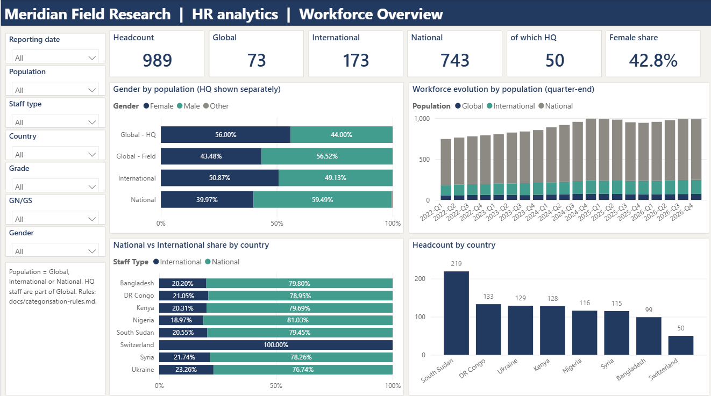
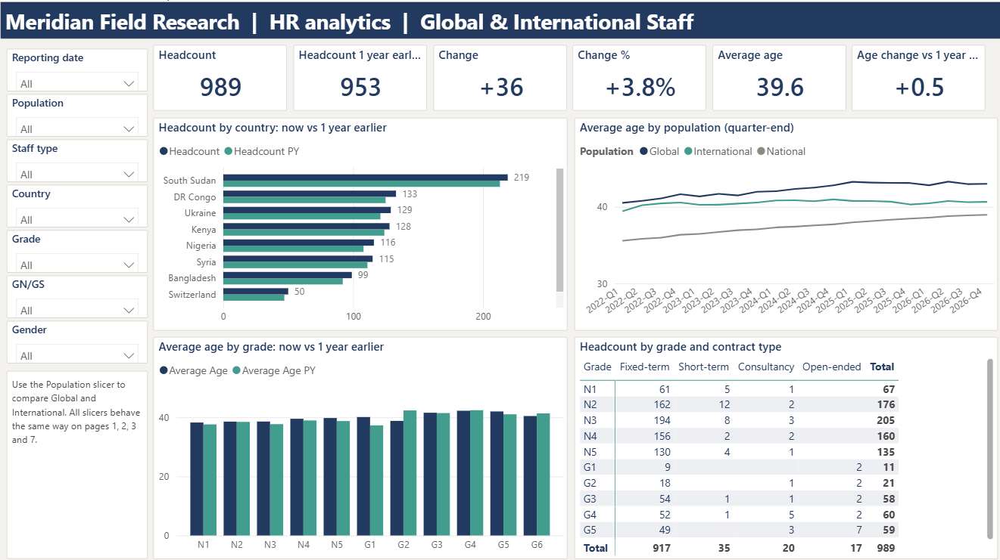
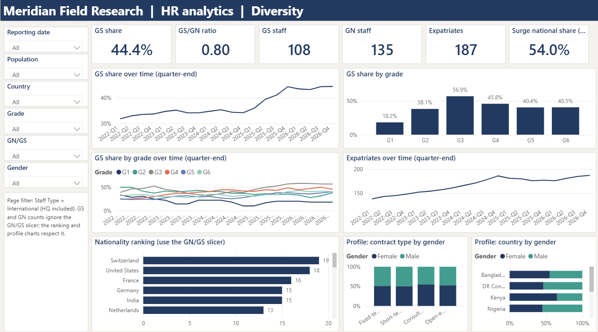
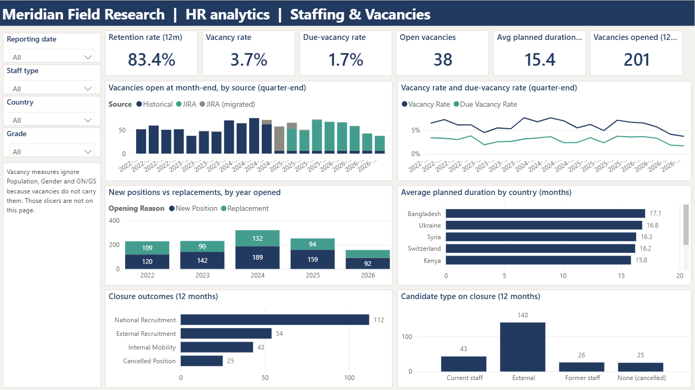
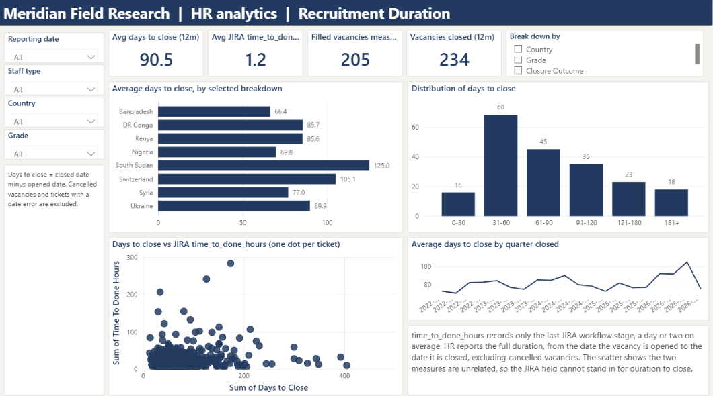
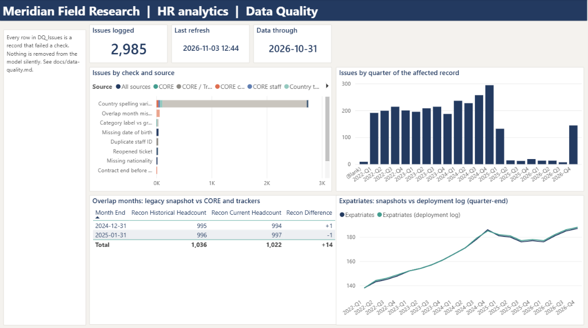

# Meridian Field Research: HR analytics in Power BI

A nine-page HR dashboard and semantic model for a fictional international humanitarian NGO, Meridian Field Research (MFR), headquartered in Geneva.
All data in this repository is synthetic.

The project shows how fragmented HR sources are combined into one star schema, how workforce categories are fixed with a transparent rule table,
and how data-quality problems are surfaced instead of hidden. The model, the report and the documentation are in text form (TMDL and PBIR), so every change is reviewable in Git.

## Screenshots

| | |
|---|---|
|  |  |
|  |  |
|  |  |

Model view: `docs/img/model_view.png`

## The problem

MFR reports on about 1,000 staff in eight countries of operation plus HQ. The data sits in four places that do not agree with each other:

| Source | Content | Problem |
|---|---|---|
| CORE (HR system, since January 2025) | International and HQ staff, contracts, appraisals | Replaced a legacy system; starts mid-history |
| JIRA recruitment board | Vacancies and surge requests | Exports `time_to_done_hours`, which is not the duration HR needs |
| Country trackers (Excel, one per country) | National staff | Different headers, header rows and date formats per country |
| Legacy Excel files, 2022 to 2024 | Month-end snapshots and event logs | Old labels, text dates, country spelling variants, one month of overlap with CORE |

## What the model does

- **Categorises staff by rule.** Staff Type comes from the grade scale, Population (Global, International, National) from country, staff type and unit. The rules live in a mapping workbook, not in the report. See `docs/categorisation-rules.md`.
- **Combines sources with an explicit cut-over.** Legacy snapshots up to 31 Dec 2024, CORE and trackers from 31 Jan 2025. Both feeds are kept for the two overlap months so the difference is visible.
- **Writes documented DAX.** 63 measures with descriptions, in display folders by page. Vacancy rate, retention, turnover, days to close, GS/GN ratio, contract expiry. See `docs/measure-definitions.md`.
- **Reports data quality.** `DQ_Issues` has one row per failed check (country spelling, duplicate IDs, label versus grade, resolved before created, contract end before start and others). Page 9 summarises them.
- **Validates itself.** `tests/expected_kpis.csv` holds 46 reference values computed independently in pandas; `tests/validation_queries.dax` returns the same values from the model.

## Pages

| # | Page | Main content |
|---|---|---|
| 1 | Workforce Overview | Headcount by population, gender including HQ, evolution, country mix, map |
| 2 | Global & International Staff | Country headcount now and a year earlier, average age, grade by contract type |
| 3 | Diversity | GS share and GS/GN ratio overall, by grade and over time; nationality ranking; expatriates |
| 4 | Staffing & Vacancies | Retention, vacancy and due-vacancy rate, open vacancies by month, outcomes |
| 5 | Recruitment Duration | Days to close by country, grade, outcome or staff type; comparison with `time_to_done_hours` |
| 6 | Surge Deployments | Requests by country, National versus International fill |
| 7 | Retention & Turnover | Retention and turnover trends, exit reasons, appraisal completion |
| 8 | Contracts | International G3/G4 contract durations, contracts ending in four months |
| 9 | Data Quality | Issues by check and source, overlap-month reconciliation |

Layout details are in `docs/report-spec.md`.

## Repository

```
data_generator/   Seeded generator for the synthetic sources (python data_generator/generate.py)
data/             Source files: core_hris, jira, country_trackers, historical, reference
powerbi/          Power BI project: semantic model (TMDL), report (PBIR), theme
tests/            Data tests, reference KPIs, validation DAX
docs/             Sources, model, measures, rules, data quality, report spec, test log, guides
```

## Run it

Python 3.11 or later.

```
pip install -r requirements.txt
python data_generator/generate.py     # rewrites data/ and tests/expected_kpis.csv (seed 2026)
pytest                                # 46 checks on the data and the reference KPIs
```

Open `powerbi/MFR_HR_Dashboard.pbip` in Power BI Desktop (enable the Power BI Project, TMDL and PBIR preview options if the version asks for them).
In *Transform data > Manage parameters* set `DataFolder` to the full path of the `data` folder, then refresh.

## Headline figures at 31 October 2026

Reporting date 31 Oct 2026. Values from `tests/expected_kpis.csv`.

| Measure | Value |
|---|---|
| Headcount | 989 (743 National, 173 International, 73 Global of which 50 HQ) |
| Retention rate, 12 months | 83.4% (75.6% a year earlier, the Afghanistan office closed in 2025) |
| Turnover rate, 12 months | 17.6%, of which voluntary 6.0% |
| Vacancy rate | 3.7% (38 open vacancies) |
| Average days to close | 90.5; the JIRA `time_to_done_hours` averages 1.2 days |
| GS share of International staff | 44.4% (42.1% a year earlier) |
| International contracts ending within four months | 68, 27.6% of International headcount |

## Documentation

| Document | Content |
|---|---|
| `docs/data-sources.md` | Each source, owner, refresh, dependencies, limits |
| `docs/data-model.md` | Grain per table, relationships, ER diagram, combination rules |
| `docs/measure-definitions.md` | Definitions and DAX for every measure |
| `docs/categorisation-rules.md` | Staff Type and Population rules with examples |
| `docs/data-quality.md` | Planted problems, handling, known limitations |
| `docs/report-spec.md` | Position and fields of every visual |
| `docs/test-log.md` | Test cases for the report |
| `docs/user-guide.md` | For HR users |
| `docs/maintenance-guide.md` | Refresh, add a tracker, change the mapping |

## Design decisions

- **One reporting date.** A disconnected month-end table drives every "at date" measure, so cards, trends and year-on-year comparisons agree.
- **Grade decides Staff Type.** Source labels are unreliable (some national-grade staff are labelled International), so label conflicts are logged and not trusted.
- **Nothing is dropped silently.** Repairs (contract end dates, resolved-before-created tickets) are applied in the model and every repaired record appears in `DQ_Issues`.
- **Full duration, not `time_to_done_hours`.** The JIRA field covers only the last workflow stage.
- **Synthetic and pseudonymised.** Staff are identified by `EMP-nnnnnn` only. The GN/GS classification is illustrative.

## Licence

MIT. See `LICENSE`.
