# Data model

Star schema in Power BI project format (TMDL). Dimensions filter facts in one direction. Natural text keys are used because every key is a short, stable label.

## Tables and grain

| Table | Grain | Source |
|---|---|---|
| `DimDate` | Day, January 2022 to the data-through date. `Month End` and `Is Month End` columns | Power Query |
| `Reporting Date` | Month-end. Disconnected, drives the slicer | Power Query |
| `DimCountry` | Country (region, is HQ, office status) | `reference/country_list.xlsx` |
| `DimNationality` | Nationality (GN/GS), plus Unknown | `reference/gn_gs_nationality.xlsx` |
| `DimGrade` | Grade (staff type, band, sort) | `reference/staff_category_mapping.xlsx` |
| `DimPopulation` | Population Detail (Global - HQ, Global - Field, International, National) with Population above it | Inline |
| `DimContractType` | Contract type | Mapping workbook |
| `DimGender` | Gender | Inline. Added so the Gender slicer filters staff and exits alike |
| `FactStaffMonthly` | Employee x month-end | Legacy snapshots up to the cut-over, CORE contracts and trackers after |
| `FactContracts` | Contract | CORE contracts |
| `FactExits` | Exit event | Leavers log, CORE, trackers |
| `FactVacancies` | Vacancy | Legacy vacancy log and JIRA |
| `FactVacancyMonthly` | Vacancy x month-end while open | Derived from `FactVacancies` |
| `FactSurges` | Surge request | Legacy surge log and JIRA |
| `FactAppraisals` | Appraisal | CORE |
| `FactExpatriation` | Deployment | Legacy expatriation log and CORE |
| `DQ_Issues` | One row per failed check | Power Query |
| `Recon_Overlap` | Employee x overlap month x source | Legacy snapshots and current feed |
| `Refresh Info` | One row | Power Query |
| `Breakdown` | Field parameter | Page 5 |
| `_Measures` | Holds measures | |

## Relationships

All are many-to-one, single direction, from the dimension to the fact.

| Fact | Key | Dimension |
|---|---|---|
| `FactStaffMonthly` | `Month End` | `DimDate[Date]` |
| `FactStaffMonthly` | `Country` | `DimCountry[Country]` |
| `FactStaffMonthly` | `Nationality` | `DimNationality[Nationality]` |
| `FactStaffMonthly` | `Grade` | `DimGrade[Grade]` |
| `FactStaffMonthly` | `Contract Type` | `DimContractType[Contract Type]` |
| `FactStaffMonthly` | `Population Detail` | `DimPopulation[Population Detail]` |
| `FactStaffMonthly` | `Gender` | `DimGender[Gender]` |
| `FactExits` | `Exit Date` | `DimDate[Date]` |
| `FactExits` | `Country` | `DimCountry[Country]` |
| `FactExits` | `Nationality` | `DimNationality[Nationality]` |
| `FactExits` | `Grade` | `DimGrade[Grade]` |
| `FactExits` | `Contract Type` | `DimContractType[Contract Type]` |
| `FactExits` | `Population Detail` | `DimPopulation[Population Detail]` |
| `FactExits` | `Gender` | `DimGender[Gender]` |
| `FactContracts` | `Start Date` | `DimDate[Date]` |
| `FactContracts` | `Country` | `DimCountry[Country]` |
| `FactContracts` | `Grade` | `DimGrade[Grade]` |
| `FactContracts` | `Contract Type` | `DimContractType[Contract Type]` |
| `FactContracts` | `Population Detail` | `DimPopulation[Population Detail]` |
| `FactVacancies` | `Opened Date` | `DimDate[Date]` |
| `FactVacancies` | `Closed Date` (inactive, used with USERELATIONSHIP) | `DimDate[Date]` |
| `FactVacancies` | `Country` | `DimCountry[Country]` |
| `FactVacancies` | `Grade` | `DimGrade[Grade]` |
| `FactVacancyMonthly` | `Month End` | `DimDate[Date]` |
| `FactVacancyMonthly` | `Country` | `DimCountry[Country]` |
| `FactVacancyMonthly` | `Grade` | `DimGrade[Grade]` |
| `FactSurges` | `Request Date` | `DimDate[Date]` |
| `FactSurges` | `Country` | `DimCountry[Country]` |
| `FactSurges` | `Grade` | `DimGrade[Grade]` |
| `FactAppraisals` | `Appraisal Date` | `DimDate[Date]` |
| `FactExpatriation` | `Start Date` | `DimDate[Date]` |
| `FactExpatriation` | `Country` | `DimCountry[Country]` |
| `FactExpatriation` | `Nationality` | `DimNationality[Nationality]` |
| `DQ_Issues` | `Record Date` | `DimDate[Date]` |
| `Recon_Overlap` | `Month End` | `DimDate[Date]` |

```mermaid
erDiagram
    DimDate ||--o{ FactStaffMonthly : filters
    DimDate ||--o{ FactExits : filters
    DimDate ||--o{ FactContracts : filters
    DimDate ||--o{ FactVacancies : filters
    DimDate ||--o{ FactVacancyMonthly : filters
    DimDate ||--o{ FactSurges : filters
    DimDate ||--o{ FactAppraisals : filters
    DimDate ||--o{ DQ_Issues : filters
    DimCountry ||--o{ FactStaffMonthly : filters
    DimCountry ||--o{ FactExits : filters
    DimCountry ||--o{ FactVacancies : filters
    DimCountry ||--o{ FactVacancyMonthly : filters
    DimCountry ||--o{ FactSurges : filters
    DimGrade ||--o{ FactStaffMonthly : filters
    DimGrade ||--o{ FactVacancies : filters
    DimGrade ||--o{ FactContracts : filters
    DimNationality ||--o{ FactStaffMonthly : filters
    DimNationality ||--o{ FactExits : filters
    DimPopulation ||--o{ FactStaffMonthly : filters
    DimPopulation ||--o{ FactExits : filters
    DimGender ||--o{ FactStaffMonthly : filters
    DimContractType ||--o{ FactStaffMonthly : filters
```

## Cut-over rule

Month-ends up to and including 31 Dec 2024 come from the legacy snapshots. Month-ends from 31 Jan 2025 come from CORE and the country trackers. The parameter `CutOver` holds the date. Both feeds also report December 2024 and January 2025; `Recon_Overlap` keeps both so the difference is visible on page 9, and `DQ_Issues` lists each person who appears in only one of them.

## How the sources are combined

1. Country and nationality text is trimmed and mapped through the variants table (`fx_CleanCountry`).
2. Tracker workbooks are read from the folder, the header row is found by looking for any known alias of Staff ID, columns are renamed through `tracker_column_map.xlsx` (`fx_StandardiseTracker`), and the country comes from the file name.
3. CORE contracts become spans (start, end, grade, contract type, country). Tracker rows become one span each, for staff IDs that CORE does not hold. A staff ID in both is taken from CORE.
4. Spans are expanded to one row per month-end. Legacy snapshot rows are already at that grain.
5. Staff Type and Population are derived with `fx_Derive` and the mapping workbook (docs/categorisation-rules.md).
6. A contract whose end date is before its start date gets end = start + granted months - 1 day, and a row in `DQ_Issues`.
7. Vacancies: JIRA tickets that carry a `legacy_vacancy_ref` replace the legacy row, keeping the legacy opened date. A JIRA ticket resolved before it was created is closed on its creation date and excluded from duration measures.
8. Every fact row carries a `Source` column.

## Differences from the original plan

- `DimGender`, `Recon_Overlap` and `Refresh Info` were added.
- `DimPopulation` is keyed on Population Detail so that HQ can be shown on its own. Staff Type lives on `DimGrade`, which also filters vacancies.
- The calculation group `Time Comparison` was not built. Prior-year measures are explicit instead (`Headcount PY`, `Average Age PY`).
- The `Breakdown` parameter offers Staff Type where the plan said Population, because a vacancy has no Population.
